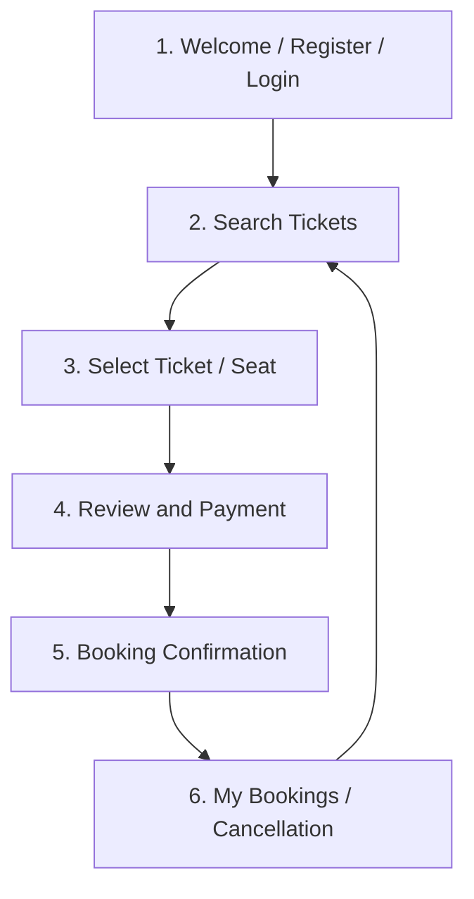

# Ticket Reservation System — Storyboard

This storyboard describes six main screens in the proposed application.

## Screen 1 — Welcome, Registration and Login
**Elements:** Application title, brief introduction, Register form, Login form, navigation to ticket search.

**User action:** A new user registers with the required details, or an existing user signs in.

**System response:** Validate the submitted details. On success, take the user to the search screen. On failure, show a clear validation message.

## Screen 2 — Search Tickets
**Elements:** Search fields appropriate to the selected ticket domain (for example, source and destination for transport, or movie/event and date), date, and passenger/ticket quantity.

**User action:** Enter search details and submit.

**System response:** Display matching services, schedules, prices, and availability. If no result is found, explain this and allow another search.

## Screen 3 — Select Ticket or Seat
**Elements:** Search result details, available seats or ticket quantities, price per ticket, and selection summary.

**User action:** Choose an available seat or quantity.

**System response:** Show the selected option and calculate the estimated total. Recheck availability before final booking to avoid duplicate reservations.

## Screen 4 — Booking Review and Payment
**Elements:** Booking summary, user/passenger details, selected seats or quantity, date/time, total amount, and confirm/back controls.

**User action:** Review the details and confirm. For a laboratory prototype, use a simulated payment or an approved payment sandbox only.

**System response:** Validate the booking and record the payment result. Do not request or store real card details in a student demo.

## Screen 5 — Booking Confirmation
**Elements:** Success or failure message, unique booking reference, reservation summary, and link to My Bookings.

**User action:** View or save the confirmation.

**System response:** Store a successful reservation and make its details available in the user's booking history.

## Screen 6 — My Bookings and Cancellation
**Elements:** List of the signed-in user's current and previous reservations, booking status, details, and cancellation option where allowed.

**User action:** View a booking or request cancellation.

**System response:** Show the booking details and apply the project's cancellation rules. Update the booking status and availability consistently.

## Screen flow

## Acceptance criteria
- The user can register or sign in with validated details.
- Search results correspond to the submitted search criteria.
- The user can select only tickets that are available at confirmation time.
- The total is visible before confirming the booking.
- A successful booking receives a unique reference.
- Users can access only their own bookings.
- Cancellation changes the reservation status according to defined rules.
